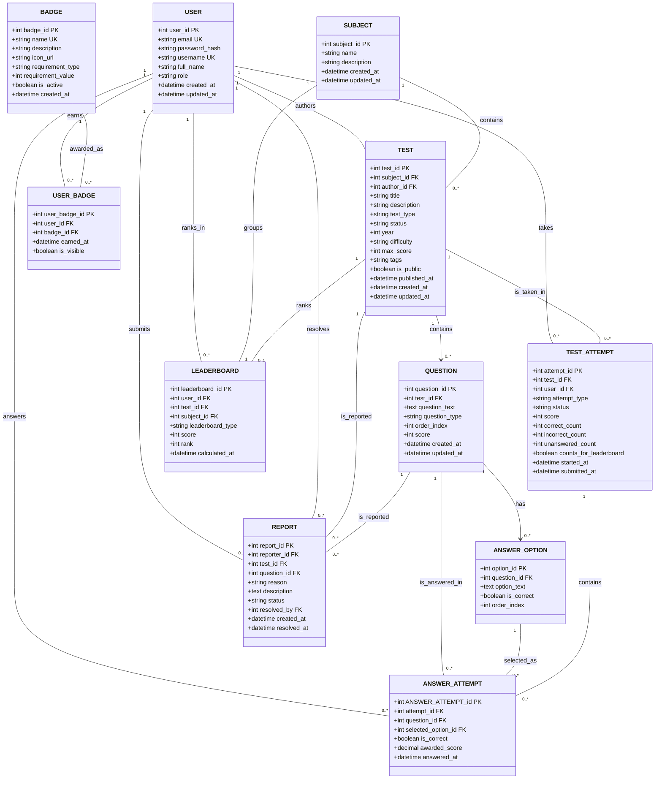

# FBI API

The FBI API is the backend being developed for FBI, a platform that helps students, primarily at the University of Lleida, prepare for their subjects through tests. It supports practice and self-assessment, progress tracking, and friendly competition through reliable scores and leaderboards.

The capabilities below describe the intended platform and are not necessarily implemented yet. For the role model, domain rules and detailed requirements, see [Platform Roles, Features and User Stories](docs/Context-FBI.md) and [User Stories](docs/User-Stories-FBI.md).

## Vision

FBI aims to give students an accessible way to explore subject material, practice with official and custom tests, review their results and measure their progress. The platform also aims to maintain fair competition and trustworthy content through automatic grading, privacy protections and administrative moderation.

Official test attempts can contribute to subject and global leaderboards using each student's personal best per eligible test. Custom tests are for practice and do not contribute to competitive rankings. Recorded results remain fixed when scoring criteria change.

## Features per Stakeholder

The roles are hierarchical: students can use public visitor features, and administrators can also use student features, subject to competitive restrictions.

| Visitor | Student | Administrator |
| --- | --- | --- |
| Browse subjects and published public tests; search or filter the catalog and view public test details | Take official and custom tests; review scores, correct answers, mistakes and test history | Manage subjects and create, edit, publish, withdraw and validate official tests, questions and answer options |
| View featured tests, public profiles, and subject and global leaderboards | Participate in subject and global leaderboards through eligible official test attempts | Moderate student-created content, review reports and resolve issues |
| Register, log in and recover a forgotten password | Create, publish and manage custom practice tests | Monitor statistics and manage leaderboards for justified administrative reasons |
| | Earn badges, manage profile information, and report content or platform problems | Use student features for validation and practice; administrator attempts do not count toward leaderboards and administrators cannot earn student badges |

## Entities Model

The following diagram describes the project domain model; it is not a statement that all entities and features are implemented. See the project documentation for detailed rules and proposed implementation conventions.

## AI-Assisted Spec-Driven Development (SDD)

The API is developed using **AI-Assisted Spec-Driven Development (SDD)** with **Spring Data REST** and **Cucumber BDD**.

It is pre-configured with agent skills (`skills/`), repository instructions (`AGENTS.md`, `CONVENTIONS.md`), and Aider configuration (`.aider.conf.yml`) to support both:
1. **Full-Capability AI Agents** (OpenCode, Claude Code, Cursor, GitHub Copilot, Windsurf).
2. **Token-Constrained APIs** (Aider paired with Groq free tier - 8K token limits).

For complete stage-by-stage instructions and command workflows, see **[AI_DEVELOPMENT_GUIDE.md](AI_DEVELOPMENT_GUIDE.md)**.

### SDD Agent Skills (`skills/`)
- **`skills/sdd-feature-designer/SKILL.md`**: Draft Cucumber `.feature` specs for Spring Data REST endpoints (<50 lines).
- **`skills/sdd-cucumber-steps/SKILL.md`**: Implement MockMvc step definition classes extending `StepDefs.java`.
- **`skills/spring-datarest-entity/SKILL.md`**: Create JPA `@Entity` classes extending `UriEntity` and `@RepositoryRestResource` interfaces with SpEL row-level security queries.
- **`skills/spring-datarest-handler/SKILL.md`**: Create lifecycle event handlers based on the `@RepositoryEventHandler`.
- **`skills/sdd-bdd-verifier/SKILL.md`**: Run `mvn test -Dtest=CucumberTest` and analyze test failure summaries.
